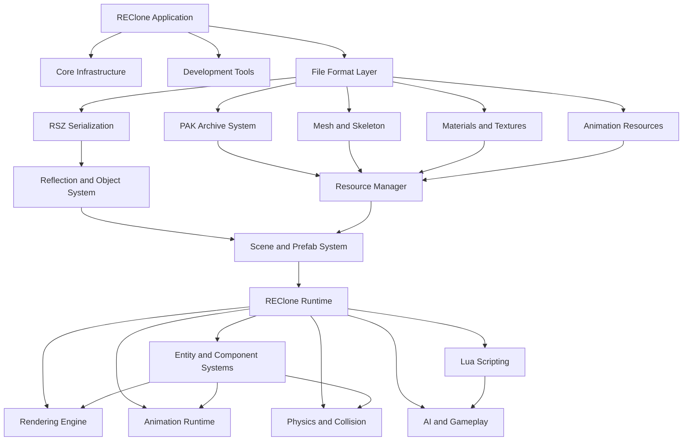

# REClone 🚀

[](./LICENSE)
[](#roadmap)
[](#architecture)
[](#contributing)

**REClone is an independent, community-driven engine research and development project inspired by Capcom's RE Engine architecture.**

Our objective is to study, understand and independently implement the technologies, systems and workflows required to build a modern, modular game engine capable of handling complex 3D environments, resource management, animation, scene composition and gameplay systems.

The project builds upon publicly available reverse-engineering research, existing modding tools, documented file formats and community knowledge.

REClone is not a modification of Capcom's proprietary engine source code. It is an independent implementation built for research, experimentation and game development.

---

# 🌍 1. Project Vision

REClone aims to develop an independent engine architecture inspired by the technical concepts and capabilities observed in RE Engine.

Our long-term objectives are:

- Develop an independent reflection and serialization system inspired by RSZ.
- Build a modular resource and asset management architecture.
- Implement entity, component and scene management.
- Reconstruct and support documented RE Engine asset formats.
- Develop a complete 3D asset pipeline.
- Implement skeleton and animation systems.
- Build a flexible material and rendering architecture.
- Integrate Lua for gameplay scripting.
- Develop physics, collision and AI systems.
- Create tools for inspecting, editing and converting supported resources.
- Establish a community-driven research and development environment.

**Our goal is not simply to extract game assets. It is to understand how the systems work together and build an independent engine capable of using similar concepts.**

---

# 🧠 2. Architectural Philosophy

REClone follows a modular, metadata-driven architecture.

The architecture separates file-format interpretation, serialization, resource management, runtime systems and development tools.

This allows individual systems to be developed, tested and improved independently.

## Architecture Overview



*This is the proposed REClone architecture, not a representation of Capcom's confirmed internal implementation.*

## Core Architectural Principles

1. **Modularity:** Every major subsystem should have a defined interface and independent implementation.
2. **Metadata-driven design:** Reflection and serialization should be data-driven rather than dependent on hardcoded game-specific structures.
3. **Resource independence:** Assets should be managed independently from the systems that consume them.
4. **Extensibility:** New formats, game profiles and runtime systems should be addable without redesigning the entire engine.
5. **Validation first:** Every implemented format must have reproducible tests.
6. **Research transparency:** Confirmed findings, hypotheses and experimental implementations must be clearly distinguished.

---

# 🔬 3. Reverse-Engineering Research Foundation

REClone builds upon existing community research into RE Engine.

We will not unnecessarily reinvent already documented file formats or duplicate mature implementations.

Instead, existing projects will serve as research references, format specifications and potential integration points.

## Important research projects

| Project | Research area |
|---|---|
| [REFramework](https://github.com/praydog/REFramework) | Runtime inspection, Lua scripting and engine interaction |
| [REFramework Book](https://cursey.github.io/reframework-book/) | REFramework documentation and scripting |
| [RE_RSZ](https://github.com/alphazolam/RE_RSZ) | RSZ research and serialization |
| [REE-Lib](https://github.com/kagenocookie/RE-Engine-Lib) | RE Engine resource and format tooling |
| [REasy](https://github.com/seifhassine/REasy) | Resource inspection and editing |
| [REasy Wiki](https://github.com/seifhassine/REasy-Wiki) | File format and tool documentation |
| [REE-Content-Editor](https://github.com/kagenocookie/REE-Content-Editor) | Content inspection and editing |
| [RE Engine Modding Documentation](https://github.com/Havens-Night/REEngine-Modding-Documentation/wiki) | Modding and format research |
| [RE-010-Templates](https://github.com/alphazolam/RE-Engine-010-Templates) | Binary format inspection |

Additional projects can be discovered through:

[GitHub RE Engine Topic](https://github.com/topics/re-engine)

**Important:** Existing projects are research references, not automatically approved dependencies. Before integrating code or metadata, we will review licenses, attribution requirements, maintenance status and technical compatibility.

---

# 🧬 4. Core Systems

## 4.1 Reflection and Serialization System

The reflection and serialization subsystem is one of REClone's highest priorities.

RSZ research provides an important starting point for understanding object types, serialized instances, references and component structures.

Planned functionality:

- Type registration.
- Type identifiers.
- Field metadata.
- Object construction.
- Inheritance information.
- Serialization and deserialization.
- Object references.
- Array and collection handling.
- Version-aware format handling.
- Validation and error reporting.

Proposed internal structure:

```cpp
struct FieldDescriptor
{
    std::string name;
    uint32_t offset;
    uint32_t typeId;
};

struct TypeDescriptor
{
    std::string name;
    uint32_t typeId;
    uint32_t size;

    std::vector<FieldDescriptor> fields;
};

class ReflectionRegistry
{
public:
    void registerType(const TypeDescriptor& type);

    const TypeDescriptor* findType(
        uint32_t typeId
    ) const;
};
```

This is an initial REClone design, not a claim that the actual RSZ format uses these exact structures.

## 4.2 Resource and Archive Management

The resource manager will provide a central interface for loading, identifying and accessing resources.

Planned functionality:

- PAK archive indexing.
- Resource extraction.
- Resource identification.
- Dependency tracking.
- Resource caching.
- Reference resolution.
- Game-specific resource profiles.
- Resource validation.

The resource manager should be independent of rendering and gameplay.

## 4.3 Entity and Component Architecture

REClone will implement an independent entity-component architecture.

The objective is to provide a flexible runtime for composing objects from reusable components.

Planned components:

- Transform.
- Static Mesh.
- Skinned Mesh.
- Camera.
- Light.
- Animation Controller.
- Physics Body.
- Collider.
- Audio Source.
- Gameplay Script.

Entity composition will be informed by RE Engine research, while the implementation remains independent.

## 4.4 Scene and Prefab System

The scene system will reconstruct object relationships and resource dependencies.

Planned functionality:

- Scene loading.
- Prefab loading.
- Entity creation.
- Component reconstruction.
- Transform hierarchy.
- Parent-child relationships.
- Resource references.
- Scene serialization.
- Scene editing.

Initial research targets:

- `.scn`
- `.pfb`
- RSZ-based resource structures.

## 4.5 3D Asset Pipeline

REClone requires a complete asset pipeline.

Supported research targets:

| Resource | Planned functionality |
|---|---|
| `.mesh` | Geometry, vertex attributes and mesh structures |
| `.mdf2` | Material definitions |
| `.tex` | Texture resources |
| Skeleton resources | Bone hierarchy and transforms |
| Motion resources | Animation data and tracks |

Planned functionality:

- Vertex buffer processing.
- Index buffer processing.
- Normals and tangents.
- UV channels.
- Vertex colors.
- Skin weights.
- Skeleton reconstruction.
- Material assignment.
- Texture loading.
- Asset inspection and conversion.

The asset pipeline must preserve source information wherever possible.

## 4.6 Animation System

Animation is a fundamental requirement for REClone.

The objective is to reconstruct and independently implement a runtime capable of handling skeletal animation.

Planned functionality:

- Skeleton hierarchy.
- Bone transforms.
- Animation clips.
- Translation tracks.
- Rotation tracks.
- Scale tracks.
- Animation playback.
- Animation blending.
- State machines.
- Root motion.
- Animation events.
- Retargeting.

Animation support will be developed alongside the skeletal mesh pipeline.

## 4.7 Rendering Engine

The rendering system will provide the visual foundation of REClone.

Initial objectives:

- 3D model rendering.
- Camera system.
- Transform hierarchy.
- Material system.
- Texture sampling.
- Lighting.
- Normal mapping.
- Skeletal mesh rendering.
- Animation playback.
- Scene visualization.

Potential graphics APIs:

- Vulkan.
- DirectX 12.
- OpenGL for early prototyping.

The final API selection will depend on development requirements and contributor experience.

## 4.8 Lua Scripting

Lua will provide an extensible gameplay scripting interface.

Planned functionality:

- Script loading.
- Entity access.
- Component access.
- Lifecycle callbacks.
- Event communication.
- Gameplay logic.
- AI scripting.
- Debugging support.

Example REClone scripting concept:

```lua
function on_update(entity, delta_time)

    local transform = entity:get_component("Transform")

    if transform.position.y < 0 then
        entity:destroy()
    end

end
```

This is a proposed REClone API.

## 4.9 Physics and Gameplay Systems

Long-term runtime functionality:

- Collision detection.
- Rigid body simulation.
- Character controllers.
- Physics triggers.
- Navigation.
- AI behavior trees.
- Event systems.
- Input management.
- Audio.
- Gameplay state management.

These systems will be developed after the core resource and scene architecture is established.

---

# 🏗️ 5. Proposed Repository Structure

```text
REClone/
│
├── README.md
├── LICENSE
├── CONTRIBUTING.md
├── ROADMAP.md
│
├── docs/
│   ├── ARCHITECTURE.md
│   ├── RE_ENGINE_RESEARCH.md
│   ├── RSZ_FORMAT.md
│   ├── RESOURCE_SYSTEM.md
│   ├── SCENE_SYSTEM.md
│   ├── ASSET_PIPELINE.md
│   ├── ANIMATION_SYSTEM.md
│   └── DEVELOPMENT_GUIDELINES.md
│
├── src/
│   ├── REClone.App/
│   ├── REClone.Core/
│   ├── REClone.Reflection/
│   ├── REClone.Serialization/
│   ├── REClone.Archives/
│   ├── REClone.Resources/
│   ├── REClone.Scene/
│   ├── REClone.ECS/
│   ├── REClone.Assets/
│   ├── REClone.Animation/
│   ├── REClone.Rendering/
│   ├── REClone.Physics/
│   ├── REClone.Scripting/
│   └── REClone.Gameplay/
│
├── tools/
│   ├── AssetInspector/
│   ├── RSZInspector/
│   ├── ArchiveBrowser/
│   └── ResourceConverter/
│
├── tests/
│   ├── Core.Tests/
│   ├── Reflection.Tests/
│   ├── Serialization.Tests/
│   ├── Archive.Tests/
│   ├── Scene.Tests/
│   ├── Asset.Tests/
│   └── TestData/
│
└── .github/
    ├── ISSUE_TEMPLATE/
    ├── workflows/
    │   └── build.yml
    └── PULL_REQUEST_TEMPLATE.md
```

This is the intended structure. Directories will be introduced as their corresponding implementations become available.

---

# 🧪 6. Testing and Validation

Testing is a central part of REClone development.

Every subsystem must have reproducible tests and documented limitations.

| System | Validation |
|---|---|
| Archive reader | Correct archive indexing and extraction |
| Reflection | Type and field registration |
| Serialization | Structural round-trip comparison |
| Resource manager | Dependency resolution |
| Scene loader | Entity and component reconstruction |
| Mesh loader | Geometry and vertex attribute validation |
| Skeleton | Bone hierarchy and transform validation |
| Animation | Track evaluation and playback |
| Materials | Shader and texture assignment |
| Rendering | Visual comparison |
| Lua | Script execution and lifecycle tests |

## Testing Principles

- Never mark an unsupported format as supported.
- Preserve original test files and expected results.
- Compare serialized structures rather than relying only on successful file writing.
- Test malformed and incomplete inputs.
- Record game versions and format variations.
- Keep regression tests for previously solved problems.

A feature is considered implemented only when its tests pass.

---

# 🚀 7. Development Roadmap

## Phase 1 — Research and Foundation

**Objective:** Establish a reliable technical foundation.

- [ ] Audit existing RE Engine research.
- [ ] Document known file formats.
- [ ] Establish game/version compatibility profiles.
- [ ] Define REClone architecture.
- [ ] Establish C++ build system.
- [ ] Create automated testing infrastructure.
- [ ] Implement core logging and error handling.

## Phase 2 — Reflection and Serialization

**Objective:** Establish the metadata and object foundation.

- [ ] Implement type registry.
- [ ] Implement field descriptors.
- [ ] Research RSZ structures.
- [ ] Implement RSZ header parsing.
- [ ] Implement instance reconstruction.
- [ ] Implement reference handling.
- [ ] Implement serialization.
- [ ] Establish round-trip tests.

## Phase 3 — Resource Infrastructure

**Objective:** Build the resource loading foundation.

- [ ] Implement PAK indexing.
- [ ] Implement resource extraction.
- [ ] Implement resource identification.
- [ ] Build resource dependency tracking.
- [ ] Implement caching.
- [ ] Develop resource inspection tools.

## Phase 4 — Asset Pipeline

**Objective:** Reconstruct and display 3D assets.

- [ ] Implement mesh loading.
- [ ] Implement vertex buffer processing.
- [ ] Implement skeleton reconstruction.
- [ ] Implement MDF2 material inspection.
- [ ] Implement texture loading.
- [ ] Implement asset conversion.
- [ ] Create a basic 3D asset viewer.

## Phase 5 — Scene and Prefab Runtime

**Objective:** Reconstruct complete scene structures.

- [ ] Implement object construction.
- [ ] Implement component registration.
- [ ] Implement prefab reconstruction.
- [ ] Implement scene loading.
- [ ] Resolve resource dependencies.
- [ ] Implement transform hierarchies.
- [ ] Display a complete test scene.

## Phase 6 — Animation and Rendering

**Objective:** Create a functioning 3D runtime.

- [ ] Implement skeletal animation.
- [ ] Implement animation playback.
- [ ] Implement animation blending.
- [ ] Implement camera controls.
- [ ] Implement material rendering.
- [ ] Implement lighting.
- [ ] Implement animated character rendering.

## Phase 7 — Gameplay Framework

**Objective:** Establish an independent gameplay architecture.

- [ ] Integrate Lua.
- [ ] Implement entity lifecycle.
- [ ] Implement event system.
- [ ] Implement input management.
- [ ] Implement physics integration.
- [ ] Implement collision systems.
- [ ] Implement AI foundations.
- [ ] Implement gameplay state management.

## Phase 8 — Development Environment

**Objective:** Make REClone usable as a development platform.

- [ ] Build a graphical editor.
- [ ] Implement scene hierarchy.
- [ ] Implement asset browser.
- [ ] Implement component inspector.
- [ ] Implement animation preview.
- [ ] Implement material editor.
- [ ] Implement project management.

---

# 🛠️ 8. Development Technology

Initial proposed technology stack:

| Technology | Purpose |
|---|---|
| C++20 | Core engine implementation |
| CMake | Build configuration |
| Python 3.10+ | Research and conversion tools |
| Lua | Gameplay scripting |
| Vulkan / OpenGL | Rendering |
| Git | Version control |
| GitHub Actions | Automated builds and tests |
| Catch2 or GoogleTest | Automated testing |

Final dependencies and versions will be selected and documented as implementation begins.

---

# 🤝 9. Contributing

REClone is an open-source community research and development project.

We are looking for people who want to contribute to building an independent engine inspired by RE Engine.

### Researchers

- Binary format analysis.
- RSZ serialization research.
- Resource structure documentation.
- Memory layout research.
- Engine architecture analysis.

### C++ Developers

- Reflection systems.
- Serialization.
- Resource management.
- ECS architecture.
- Rendering.
- Physics.
- Runtime development.

### Python Developers

- Format inspection.
- Conversion tools.
- Automated testing.
- Data extraction.
- Research automation.

### Technical Artists

- Mesh validation.
- Skeleton reconstruction.
- Animation testing.
- Material research.
- Rendering validation.

### Modding Community

- Test resources.
- Format documentation.
- Game compatibility testing.
- Reproducible test cases.
- Technical feedback.

## How to contribute

1. Open an issue describing the proposed feature or research.
2. Include supporting technical information where possible.
3. Discuss the implementation approach.
4. Submit a pull request.
5. Include tests and documentation.

Contributions should distinguish verified information from experimental findings.

---

# 📚 10. Research Documentation

Research findings should be documented with reproducible evidence.

Each documented format should ideally include:

- File identification.
- Known magic values.
- Header structure.
- Field descriptions.
- Offset information.
- Data types.
- Resource relationships.
- Game/version compatibility.
- Known limitations.
- Reference files and test results.

We encourage contributors to share research even when a format is only partially understood.

An incomplete but well-documented discovery is more valuable than an unsupported claim.

---

# ⚖️ 11. Legal and Licensing

REClone is an independent research and development project.

- REClone is not affiliated with, endorsed by or sponsored by Capcom.
- Capcom trademarks and intellectual property remain the property of their respective owners.
- No proprietary RE Engine source code is required or included.
- Third-party code and libraries must comply with their respective licenses.
- Game assets and proprietary resources must not be redistributed without appropriate authorization.
- Contributors should submit original implementations and properly licensed research material.

The project is distributed under the MIT License, subject to the terms of individual third-party dependencies.

---

# 🎯 12. Long-Term Objective

The long-term ambition is to establish REClone as an independent, modular 3D engine and development environment.

We want to move beyond individual file converters and isolated modding utilities.

The project should ultimately provide:

- An independent reflection and serialization framework.
- A complete resource management system.
- A scene and prefab architecture.
- A 3D asset pipeline.
- Skeletal animation.
- A rendering engine.
- Physics and gameplay systems.
- Lua scripting.
- An integrated development editor.

**We are building the foundation of an independent engine, one verified subsystem at a time.**

---

# 💬 13. Community

Interested in contributing?

- Explore the repository.
- Open research issues.
- Share technical findings.
- Submit implementations.
- Help validate supported formats.

GitHub Repository:

https://github.com/REClone-ART/REClone

**Contributors, researchers and developers are welcome.**

---

*REClone — Research. Reconstruct. Reimplement. Build independently.*
